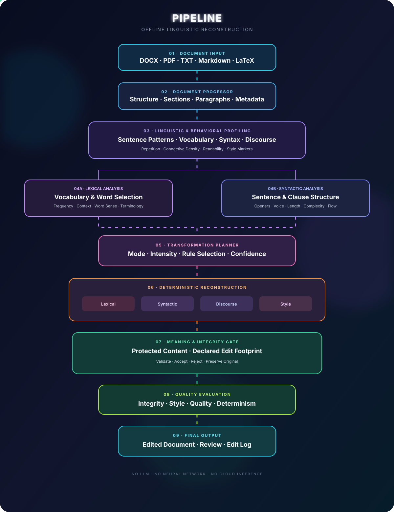
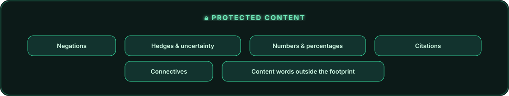
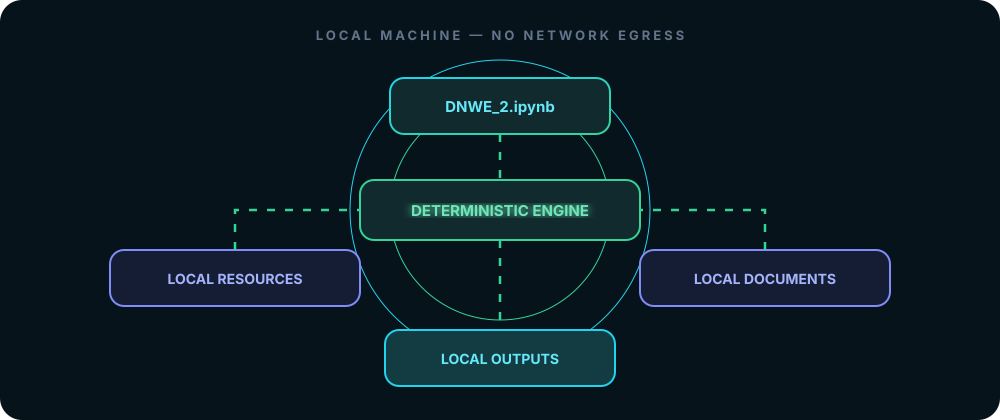

<!-- ╔══════════════════════════════════════════════════════════════╗
     ║  DNWE 2.0 · README · single-file · animated SVG workflow       ║
     ║  Animations (CSS @keyframes + SMIL) play in any renderer that  ║
     ║  shows raw HTML/SVG: browsers, VS Code preview, Obsidian, etc. ║
     ╚══════════════════════════════════════════════════════════════╝ -->

<div align="center">

<!-- ░░░░░░░░░░░░░░░░░░░  HERO  ░░░░░░░░░░░░░░░░░░░ -->


<br/><br/>


</div>

---

## ✦ The Engine at a Glance

**DNWE** studies *how* a text is written — its linguistic and stylistic fingerprint — and reconstructs its **vocabulary, syntax, and discourse** into more natural prose.

It uses **no AI models**: no LLMs, no neural networks, no cloud inference. The entire implementation lives in one executable notebook — **`DNWE_2.ipynb`**.

> [!NOTE]
> **Understand the writing · reconstruct the expression · preserve the meaning.**

---

## ⚡ Animated System Workflow

<div align="center">



</div>

---

## 🛠️ 01 — Environment & Execution

The entire system runs through one notebook.

<table>
<tr><td>

**Requirements**
- Java **17+**
- Python **3.13**
- Project virtual environment
- Dependencies in `requirements.txt`

</td><td>

**Setup**
```bash
uv venv --seed -p 3.13 .venv
.venv/bin/pip install -r requirements.txt
```

</td></tr>
</table>

### 📁 Document preparation

```text
corpus/
├── research_paper.pdf
├── technical_document.docx
├── notes.md
├── document.txt
└── latex_project/
    ├── main.tex
    ├── references.bib
    └── sections/
```

> Each LaTeX project lives in its own folder.

### ▶️ Execution

```text
┌─ 1 ─ Open DNWE_2.ipynb
├─ 2 ─ Select MODE and INTENSITY in Section 1
├─ 3 ─ Run All
├─ 4 ─ First run downloads ≈ 3 GB of resources (Section 2)
└─ 5 ─ Every run after that is fully offline
```

---

## 🎛️ 02 — Configuration

| Setting | Available options |
|---|---|
| `MODE` | `academic` · `technical` · `general` · `conversational` |
| `INTENSITY` | `conservative` · `balanced` · `extensive` |

### Transformation intensity

| Level | Behavior |
|:--|:--|
| 🟢 **Conservative** | Fixes + stock phrasing |
| 🔵 **Balanced** | Conservative + discourse / syntax reconstruction |
| 🟣 **Extensive** | Balanced + open lexical variation |

*Intensity controls the **scope** of transformations; mode controls the **writing context**.*

---

## 🔐 03 — The Meaning Gate

Every transformation must stay within its **declared edit footprint**.

<div align="center">



</div>

A proposed transformation is **rejected** if it violates the protected-content rules.

> [!IMPORTANT]
> **The objective is not simply to change the text. It is to improve its expression without silently changing what it says.**

---

## 📦 04 — Output Architecture

All generated files land in `out/`.

```text
out/
├── document.dnwe.*            → edited document, original format
├── document.dnwe.review.html  → before/after profile + per-edit explanations
├── document.dnwe.edits.csv    → editable transformation decisions
├── benchmark.csv              → quality & performance evaluation
├── stage_timings.csv          → processing time by stage
├── determinism.csv            → reproducibility measurements
├── dev_set.csv                → development labels
├── test_set.csv               → test labels
└── labels_archive.csv         → persistent label history
```

### 🔁 Human review loop

<div align="center">


</div>

To reject an individual edit, set its `decision` field to `reject`, then re-render with `apply_decisions()`.

---

## 🎯 05 — Confidence Calibration

Confidence values start as **priors**, not proven accuracy.

```text
① Section 19 → out/dev_set.csv + out/test_set.csv
② Reviewers label each development edit
③ Labels recorded as: correct · wrong · meaning
④ Section 20 → measured precision
⑤ ≥ 15 dev labels before measured precision replaces a family's prior
⑥ Families below 0.95 precision → auto-disabled
⑦ Every label kept in out/labels_archive.csv
```

> Labels follow the **edit's content**, not its position in the document — so calibration rests on actually-reviewed transformations, not arbitrary scores.

---

## 📐 06 — Style Markers

| Marker | What it examines |
|:--|:--|
| 📏 Sentence-length variation | Differences in sentence length |
| 🧱 Stock phrasing | Frequency of conventional expressions |
| 🔗 Connective density | Use of discourse connectives |
| 🔁 Repeated openers | Recurring sentence beginnings |
| ➖ Dash frequency | Use of dashes |

> [!WARNING]
> These are **linguistic & stylistic indicators**, *not* AI-detection or authorship scores. **DNWE does not optimize its transformations for any AI detector.**

---

## 🛡️ 07 — Offline Security Architecture

<div align="center">



</div>

**Enforced restrictions:** `no LLM imports` · `no neural-network imports` · `no language-model packages` · `no cloud inference` · `no remote connections` · `no runtime network dependency`.

The notebook enforces these by **blocking prohibited imports** and **refusing remote connections**.

---

## 📄 08 — Single-Paper Processing

For an individual research paper, use **Section 21** of `DNWE_2.ipynb`. The engine processes the selected document under the configured mode and intensity, then emits the edited document and its review artifacts.

---

## 🌐 09 — Local Web App

Prefer a browser to the notebook? The same engine runs behind a local web page.

```bash
.venv/bin/python server.py      # opens http://127.0.0.1:8765
```

```text
┌─ 1 ─ server.py loads Sections 1–13 of DNWE_2.ipynb (≈ 20–30 s, once per start)
├─ 2 ─ Paste text, or drop a .docx · .md · .txt · .pdf · .tex file
├─ 3 ─ Pick MODE and INTENSITY, then click Rewrite
└─ 4 ─ Rewritten text · word-level diff · every edit with its reason · style profile
```

| Piece | Role |
|:--|:--|
| `server.py` | Standard-library HTTP server on `127.0.0.1`. It runs the notebook's engine cells, so `DNWE_2.ipynb` stays the only copy of the engine. |
| `web/index.html` | Self-contained page (no CDN, works offline): input, options, results, copy and download. |

> [!TIP]
> Restart the server after you change the notebook. `--port 9000` picks another port; `--no-browser` skips opening the page.

The server answers only on `127.0.0.1` / `localhost`, refuses requests from other web pages, and runs with the notebook's offline and AI-free guards.

---

<div align="center">


<br/>

*All processing takes place locally. Initial resource acquisition needs an internet connection; every execution after that is designed to remain offline.*

</div>
